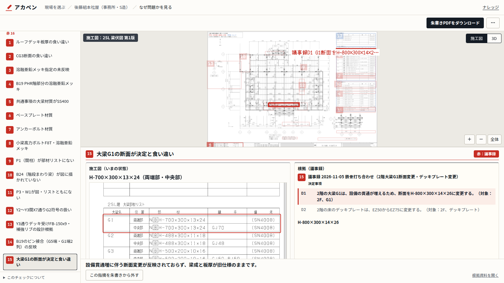
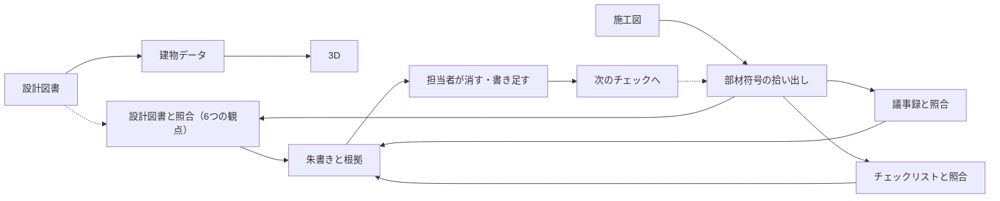
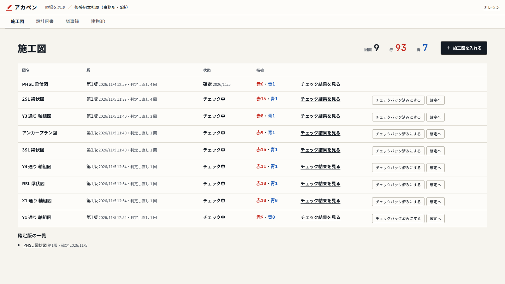
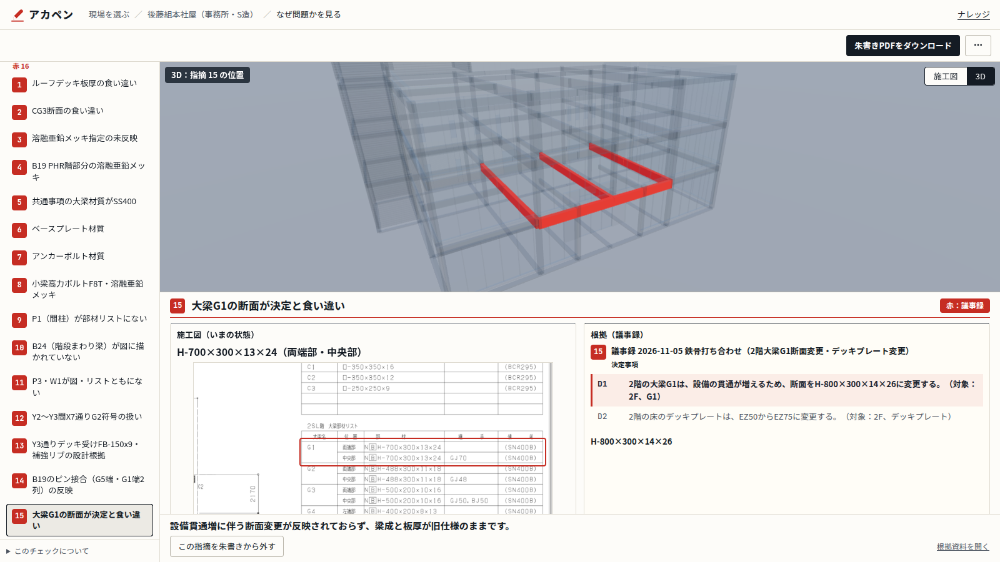
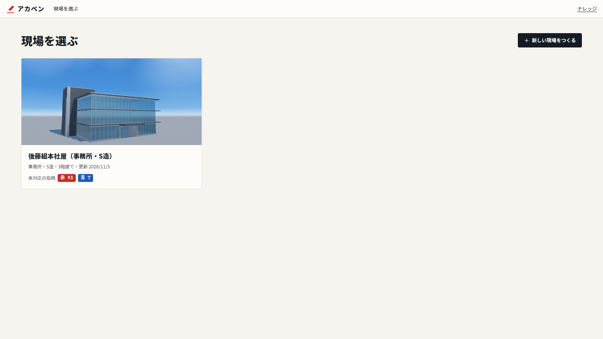

# アカペン — 施工図に、朱書きを。

建設会社で施工図をチェックする担当者は、設計図書や打ち合わせの議事録と施工図を、目と記憶で見比べています。食い違いの見落としや、決まったことの反映漏れが起きやすい作業です。
アカペンは、施工図のPDFを設計図書・議事録・社内チェックリストと Claude で照らし合わせ、食い違いの候補を朱書きにして、根拠の資料と並べて返します。

**[デモ動画（3分）](https://youtu.be/ZV1d5j9s8VI)**

- **1枚 約1分半**で、朱書きした施工図のPDFを返します
- 図面から判断できる人の指摘 **4件中2件**、誤検知 **0件**（高速化の前の方法。照合の手順を指示する前は0件）
- 現場の評価：「**青はすぐ使える、赤はまだ多い**」



Built with Claude ハッカソンの提出作品です。AIが挙げるのは確認の候補です。確定する前に人が確認してください。

## 単なる読み取り（OCR）との違い

図面の文字を読むだけでなく、複数の設計図書・議事録・社内チェックリストと照らし合わせて、食い違いを根拠つきで指摘します。

- **照合**：施工図の部材符号をすべて拾い、構造図の部材リスト・伏図・軸組図と1つずつ突き合わせます。ベテランの見比べ方を手順にしました
- **版**：差替図面と旧版を区別し、最新の版で照合します。新しい版が入ると「再チェックが必要です」と出します
- **3つの根拠**：設計図書との食い違いと、議事録の決定事項の反映漏れを赤で、社内チェックリストの観点を青で示します
- **確かさ**：PDFの文字と座標を使って、プログラムで位置や値を答え合わせし、AIの判断と組み合わせます。人の朱書きを正解にして検証しました
- **学習**：担当者が朱書きから消した判断と理由を、次のチェックに渡します



## 主な機能

- **施工図のチェック**：施工図のPDFを入れると、AIが食い違いの候補を挙げ、朱書きしたPDFを返します。赤は設計図書・議事録との矛盾、青は社内チェックリストからの指摘です
- **根拠を並べる**：指摘ごとに、施工図と根拠の資料（設計図の該当箇所、議事録の行、チェック項目）を並べます
- **朱書きを直す**：AIの朱書きを消す、人が書き足すを同じ画面でできます。消した理由は次のチェックに活かします
- **3D**：設計図書から建物の3Dを作り、指摘の位置を3D上で示します
- **議事録**：打ち合わせで決まったことを、音声やファイルから議事録にして、次のチェックに使います







<details>
<summary>画面の一覧</summary>

| 画面 | 内容 |
|---|---|
| `/` 現場を選ぶ | 現場ごとのカード（3Dの小さな画像、構造・階数、未対応の赤・青の数）。カードを開くと建物3Dのタブが出る |
| `/projects/new` | 名前と設計図書のPDFを入れ、開始前の目安を確かめて3Dをつくる |
| 現場：施工図 `/projects/[slug]` | 図面の一覧（版・状態・赤青）と合計。施工図を入れてチェックする。「チェック結果を見る」で指摘の画面へ |
| 現場：設計図書 `/design` | 図番ごとの版（最新／旧版）。新しい版を入れると建物データと3Dを更新する |
| 現場：議事録 `/minutes` | 履歴と、音声・貼り付け・ファイルからの作成 |
| 現場：建物3D `/model` | 3Dと指摘の位置。「打ち合わせで見せる」で打ち合わせの画面へ |
| 指摘 `/projects/[slug]/check/[job]` | 左に図面ごとの赤と青。右上は3Dと施工図の切り替え。右下に施工図と根拠を並べて理由を出す。朱書きから外す、PDFをダウンロードする |
| 打ち合わせ `/projects/[slug]/meeting` | 同じ3Dからチェック用の情報を外して見せる。視点、屋根を外す、階、部屋名、日当たり、議事録づくり |
| ナレッジ `/knowledge` | ヘッダーの右から開く。全現場で共通 |

</details>

## 検証結果の要点

社内の担当者が実際に朱書きした本社屋の鉄骨図（チェックバック）を正解として、アカペンの指摘と比べました。AI には人の朱書きを見せていません。

| | 前の方法（高速化の前、1枚 約5分） | 今の方法（1枚 約1分半） |
|---|---|---|
| 図面から判断できる人の指摘（2SL） | **4件中2件**、誤検知 **0件** | **4件中2件**、誤検知は未判定 |
| 調整に使っていないページ（RSL） | 人の指摘 **2件を3回とも**検出 | **2件中1件** |
| 人の朱書き30件全体 | 同じ箇所に当たったAIの指摘 **8件** | **3件** |

速さを取った代わりに、一部の指摘を拾えなくなりました。速さと拾える数の両立は、今後の課題です。

### 精度を上げた過程（2SL、図面から判断できる人の指摘4件、前の方法）

| 段階 | 拾えた数 | 誤検知の可能性 |
|---|---|---|
| 施工図と構造図だけ | 0 / 4 | 4 |
| ＋ 差替図面（最新の設計図）を入力に追加 | 1 / 4 | 1 |
| ＋ 照合の手順を指示（部材符号を全部拾い、リスト・伏図・軸組図と1つずつ突き合わせる） | **2 / 4** | **0** |

正解に合わせたヒントはプロンプトに入れていません。

### 分かったこと

- 人の朱書き（2SL）16件のうち **12件は、打ち合わせや納まりで決まったこと**で、図面同士の照合だけでは判断できませんでした。→ アカペンが **議事録** と **社内チェックリスト** も照らし合わせる理由です。
- 人とAIは見ている観点が違います。人は打ち合わせや納まり、AIは図面同士の細かな照合が得意で、**一次チェックとして組み合わせる**のが合っています。

### 現場の評価

社内の担当者に画面を見てもらった評価です。

- **青（チェックリストからの指摘）はすぐ使える**
- **赤（矛盾の指摘）はまだ多い**

赤を全部正しくするのは、まだ先になります。そこで、④の指摘の画面で、AIの朱書きを消すことと、人が朱書きを書き足すことを、同じ画面でできるようにしました。消した指摘と理由は保存し、次のチェックに渡します（`scripts/check/feedback.py`）。

<details>
<summary>この検証の範囲</summary>

- 3ページ（2SL・3SL・RSL）、人の朱書き30件での検証です。「30件中」の数には、打ち合わせ・質問など図面では分からないものに当たった指摘も含みます。
- 前の方法の数字は、高速化の前に数えたものです。今の方法では、2SL で前の方法の指摘8件のうち7件が出ています（残る1件も、指示を直した後は3回中3回出ています）。
- 人の朱書きと重ならなかったAIの指摘が正しいかは、まだ現場で確かめていません。
- 検証データは `validation/` にあります。製品の画面では使いません。
- 今の方法の数字は、11/5 に判定した結果（各ページ1回）を、人の朱書きと1件ずつ照らし合わせて数え直したものです。誤検知かどうかはまだ判定していません。

</details>

## Claude の活用

### Claude Code（開発）

| 機能 | どこで・何のために |
|---|---|
| CLAUDE.md | 公開のルール（実案件の図面を入れない、名前を出さない）、方針、残りの計画を書き、毎回の作業の前提にしました。画面の決まりは `docs/design.md` に分けて、CLAUDE.md から参照しています |
| issue 駆動 | 機能ごとに GitHub の issue を立ててから着手しました。1つ終わるごとに、画面で動かし、公開チェックを通してから push しました |
| メモリ | 途中で決めた方針を、Claude Code のメモリに残して次の作業に引き継ぎました（物件の公開の範囲、kintone は読み取りだけ、など） |
| MCP | Google ドライブ：社内の図面と資料を探して取り出しました。kintone：チェックリストのアプリの一覧を読み取りました（読み取りだけ）。kintone の施工図チェックリストは、Claude デスクトップから kintone の MCP で読み出して、ナレッジの元にしました |
| Skills | 組み込みの `claude-api` スキルで、Claude API の使い方を確かめました |
| サブエージェント | 公開前の点検で1回使いました。図面の切り抜き画像を2つに分け、塗り漏れがないかを並行して目で確かめさせました |

開発の最後に、それまで手作業で頼んでいた点検と検証を仕組みにしました（`.claude/`）。アプリ本体（画面と判定の処理）は変えていません。

| 足したもの | 何のために |
|---|---|
| フック（`.claude/settings.json`） | Claude Code が `git commit` / `git push` を実行する前に、公開チェック（`check_public.py`）を走らせ、問題があれば止めます。`.env.local` などの秘密のファイルを、Claude Code が読んだり書いたりするのも止めます |
| サブエージェント `public-checker` | 公開してはいけない情報（人名、社名、非公開の物件、ドライブID、社内URL）と、図面画像の塗り漏れを点検します。ファイルは直さず、場所を報告します |
| サブエージェント `finding-reviewer` | 施工図の判定結果を、人の朱書きと照らして採点します。どの方法で判定した結果かは伏せて渡すので、方法どうしを公平に比べられます |
| スキル `public-check` | 公開前の点検の手順です。8つの項目を、手元のファイル、GitHub の全履歴と issue、画像の順に確かめます |
| スキル `finding-check` | 施工図チェックの検証の手順です。保存済みの結果の方法を伏せ（`blind.py`）、採点させ、数えます（`tally.py`） |

- 足したものは、新しいセッションで1回ずつ動かして確かめました。採点係は保存済みの結果で試し、新しい判定は回していません
- **使っていないもの**：カスタムコマンド
- git の pre-commit フック（`.githooks/pre-commit`）でも、コミットの前に同じ公開チェックが走ります

### Claude API（製品）

| 項目 | 使い方 |
|---|---|
| モデル | すべて `claude-opus-5-5` です。モデルの使い分けはせず、処理ごとに effort を変えました（下の表） |
| 構造化出力 | すべての呼び出しで、JSON Schema を指定して決めた形式で返させています（`output_config.format`） |
| 画像とPDFの入力 | 施工図はページの画像（全体図と分割図）で渡します。設計図書は、該当ページをPDFのまま渡します |
| プロンプトキャッシュ | 設計図書の部分を1時間キャッシュし、6つの観点と複数枚の施工図で使い回します。最初の1回の応答が始まるまでほかを待たせて、キャッシュの書き込みが重ならないようにしています（`design_split.py`） |
| 並列 | 設計図書との照合を6つの観点に分けて並行します。赤（設計図書・議事録）と青（チェックリスト）も並行し、複数枚は3枚ずつ並行します |
| ストリーミング | すべての呼び出しで使い、途中で止めた呼び出しの費用も見積もります（`claude_api.py`） |
| トークン数の計測 | `count_tokens` で、呼ぶ前に費用の見込みを出します（理由の一文の追加など） |
| サーバー側のフォールバック | `server-side-fallback-2026-07-01`（beta）を指定しています |

| effort | 処理 |
|---|---|
| low | 設計図書との照合（6つの観点）、指摘の整理と重複のまとめ、赤の分類、理由の一文、ページの種類と図名の読み取り、図面枠の検出、朱書きの枠の位置合わせ |
| medium | 議事録の整理、ナレッジの取り込み、外観の読み取り |
| high（既定） | 議事録との照合、チェックリストとの照合、図面から建物データへの読み取り、本社屋の意匠図の読み取り（外装の素材、外周の壁・開口） |

- **使っていないもの**：ツール使用（tool use）、Batch API、Files API、引用（citations）、Web 検索、Agent SDK、Managed Agents
- **音声**：文字起こしは Claude ではなく、ブラウザの Web Speech API で行っています

## 今後の課題

GitHub の issue（ラベル「今後」）にも同じ内容を立てています。

### 社員インタビューで分かったこと

1. **分野をまたいだ照合**
   - 1枚の施工図を、意匠図・構造図・設備図など複数の設計図書と同時に照らし合わせ、図面同士の矛盾も見つけます。
   - 今は、構造図の中のリスト・伏図・軸組図・差替図面との照合が中心です。
   - 必要な理由：施工図を確認する担当者が困っています。食い違いは分野の境目で起きやすく、1つの分野の図面だけでは気づけません。
2. **土木への展開**
   - 土木部門ではまだ検証していません。土木で使うには、土量計算などの機能も必要という声がありました。
   - 必要な理由：土木部門の担当者が困っています。建築の施工図チェックだけでは、土木の図面確認の手間が減りません。

### この7日間で見えた課題

3. **赤の精度**
   - 現場の評価は「赤はまだ多い」でした。消した判断の学習を続けます。
   - 必要な理由：施工図を確認する担当者が困っています。赤が多いと、確かめて消す手間が増え、本当の矛盾が埋もれます。
4. **指摘の位置の精度**
   - 必要な理由：朱書きを見て図面を直す人が困っています。枠がずれると、どこを直すのかを探す手間が掛かります。
5. **構造以外（内装・建具など）の施工図への、赤の照合**
   - 必要な理由：内装・建具の施工図を確認する担当者が困っています。今は青（チェックリスト）だけで、設計図書との矛盾を拾えません。
6. **外観を読み取っている間の、進み具合の表示**
   - 必要な理由：物件を登録する人が困っています。読み取りに時間が掛かり、進んでいるのか止まっているのかが分かりません。
7. **社内での運用**
   - ログインと権限、kintone への結果の書き戻し、新しい版での指摘の解消確認です。
   - 必要な理由：社内で使う全員が困っています。誰が確定したかを確かに残し、チェックの記録を社内の仕組みとそろえ、前の指摘が直ったかを追える必要があります。

### そのほか

- 図面をまたいだ指摘のまとめ（共通事項の同じ指摘が、図面ごとに出ます）
- 3Dの細部（内壁、床の仕上げ、扉、階段・EVの形）と .glb の書き出し
- お客様向けの閲覧画面

## 使い方

```
npm install
python3 -m venv .venv && .venv/bin/pip install -r scripts/check/requirements.txt
git config core.hooksPath .githooks   # 公開チェックに通らないコミットを止める
npm run dev
```

http://localhost:3000 を開きます。デモの本社屋の3Dと判定済みの指摘は、これだけで見られます。リポジトリの判定済みの指摘は、設計図書との照合だけです。動画の議事録の赤と青は、非公開の議事録とナレッジを使った結果です。

施工図のチェックと物件の登録には、さらに次が必要です。

- `.env.local` の `ANTHROPIC_API_KEY`
- `~/sekozu-data/projects.json`：物件ごとの設計図書の登録（書き方は `scripts/check/projects.example.json`）
- `~/sekozu-data/knowledge/` のチェックリスト（JSON。`sekozu-checklist-knowledge.json` に `[{"name": ..., "items": [{"no", "section", "item", "checks", "criteria"}]}]` の形でまとめて置ける）
- 日本語フォント（Noto Sans CJK。別の場所にあるときは `SEKOZU_FONT` で指定）

音声の議事録は Chrome で、localhost か https で開いたときに使えます。

**図面はClaude APIで処理されます。** 入れた施工図と照合に使う設計図書は、判定のためにAnthropicのAPIへ送られます。送ってよい図面かを確かめてから使ってください。入れた図面と結果はリポジトリの外（`~/sekozu-data/`）に保存します。

APIの費用が掛かるので、施工図のチェックと登録は開発サーバーでだけ動きます。本番のサーバーでは `SEKOZU_ENABLE_UPLOAD=1` を設定したときだけ動きます。

## 詳細

<details>
<summary>処理時間と費用（実測）</summary>

本社屋の鉄骨施工図9枚で測りました。各1回の値です。

| 項目 | 結果 |
|---|---|
| 1枚の時間 | 58〜96秒（**約1分半**）。前の方法では約5分15秒 |
| 1枚の費用 | 約1.4〜2.6ドル。複数枚でも設計図書のキャッシュの書き込みは最初の1回だけ |
| 複数枚 | 3枚ずつ並行。5枚で163秒 |

速くするために、照合を6つの観点（部材リスト、差替の赤枠、共通事項、符号の有無、配置、詳細図）に分けて並行に判定し、最後に文面で整理しています。

</details>

<details>
<summary>技術構成</summary>

| 部分 | 使ったもの |
|---|---|
| 画面 | Next.js（App Router）、TypeScript |
| 3D | three.js（@react-three/fiber） |
| AI | Claude API（`claude-opus-5-5`）。構造化出力とプロンプトキャッシュ |
| 図面の処理 | Python（PyMuPDF）。`scripts/check/` |
| 音声 | ブラウザの Web Speech API（文字起こしはブラウザで行う） |
| 保存先 | ローカルのファイル（`~/sekozu-data/`） |

</details>

<details>
<summary>施工図チェックの赤と青</summary>

| 色 | 根拠 | 方法 |
|---|---|---|
| 赤 | 設計図書 | 施工図と設計図書（差替図面を含む）を渡し、6つの観点で別々に確かめて整理する（`design_split.py`） |
| 赤 | 議事録 | 議事録を項目に分け、項目ごとに施工図に反映されているかを確かめる |
| 青 | チェックリスト | 施工図の種類から使うチェックリストを選び、項目ごとに確かめる。図面だけでは判定できない項目は判定しない |

- 赤は矛盾だけにします。どの資料にも根拠がない表記不足は、ナレッジに当てはまれば青にし、当てはまらなければ出しません
- 同じ原因の指摘は、場所と根拠を残して1件にまとめます。SL と FL の換算で一致する指摘は、プログラムの計算で外します
- 赤と青が同じ箇所・同じ内容を指摘したときは、枠を1つにまとめ、両方の根拠を残します
- 朱書きPDFの元の図面は書き換えません。朱書きは別の層です
- 判定の前に、議事録とナレッジが入っているかを確かめます。入っていなければ、AIを呼ばずに止めるか、ないと承知で始めるかを選びます

</details>

<details>
<summary>議事録</summary>

物件ごとに持ち、赤（議事録との矛盾）はその物件の議事録だけを対象にします。

- **音声**：ブラウザの音声認識で文字にし、Claudeが決定事項・宿題・対象部位に整理します
- **貼り付け**：文章を貼り付けて同じように整理します
- **ファイル**：PDF・Word（.docx）・テキストを読み、日付と題名も読み取ります。複数回の打ち合わせは回ごとに候補を出します

保存の前に確認と編集の画面を挟みます。ファイルから作ると、指摘の根拠に出典を出します。PDFは該当ページを開き、Wordとテキストは読み取った本文の該当箇所をハイライトします。Wordのレイアウトは再現しません。

</details>

<details>
<summary>ナレッジ</summary>

PDF・Word・Excel・CSVを入れると、AIが「チェック項目・確認すること・判断の基準・対象の図面の種類」に整理します。確認画面で直してから登録します。1項目ずつ足すこともできます。

</details>

<details>
<summary>図面台帳</summary>

設計図書をページごとに図番・図名で一覧にし、新しい版を入れると元のページに束ねます。判定ごとに照合した版を記録し、新しい版が入ると「再チェックが必要です」と出します。施工図は 提出／チェック中／チェックバック済み／確定 で管理します。確定すると担当者と日時を記録し、指摘を変更できなくなります。担当者の名前は記録にだけ残し、画面には出しません。

</details>

<details>
<summary>図面の読み取り → 建物データ → 3D</summary>

1. 図面枠の題名の文字でページの種類を判定し、必要なページだけを読みます。差替図面に同じ題名があれば、そちらを読みます
2. ページの画像をClaudeに読ませて、決めた形式（JSON）で返してもらいます
3. PDFから取り出した文字と突き合わせ、違えば文字の値を使います
4. 寸法の合計や符号をプログラムで検算し、合わないところを「要確認」にします
5. 建物データからプログラムで3Dを組み立てます。AIに形を描かせません

本社屋は意匠図の平面図と立面図も読み、外周の壁、開口、屋根、部屋名を足しています。窓の高さは仮の値です。塔屋の外周と外部階段は図面を見て補正しました。日当たりは、建設地の代表点（都道府県）と建物の向きから計算します。

</details>

<details>
<summary>公開データの扱い</summary>

- **公開するのは後藤組本社屋（自社物件）だけ**です。公開の了承を得ています。データは `demo-data/sample-b/` にあります
- 実案件の図面はリポジトリに入れません（`~/sekozu-data/` に置きます）
- **塗りつぶし**：公開・デモ用の表示では、設計事務所名、製作会社名、担当者名、出図印などの図面枠の欄を塗りつぶします。図面枠はページごとにAIで見つけ、工事場所の行と禁止語はプログラムでも必ず塗ります。塗れなかった資料は公開用の表示に出しません
- 公開する画像は目で確認して `demo-data/image-review.json` に記録します
- 社内のチェックリストはリポジトリに入れていません
- デモの議事録は架空の内容で、リポジトリには入れていません
- コミットの前に `scripts/check/check_public.py` が、実名、実寸法、確定者の名前、チェックリストの文、確認していない画像が混ざっていないかを調べます

</details>

<details>
<summary>対応範囲と未検証の範囲</summary>

- 入力はPDFのみです（議事録とナレッジは別の形式も読めます）。JWW、DXF、DWG は使いません
- 精度を測ったのは本社屋の該当ページだけです。ほかの図面、ほかの工種の精度は分かりません
- 3Dなしで終わる登録は、一時的に作った状態で画面を確かめただけです
- 外観と部屋は本社屋だけです
- 3Dは初期検討用のイメージです。寸法の精度は保証しません
- ログインがないので、確定の担当者は入力した名前です

</details>

## 注記

コードはすべてハッカソン期間中に新規に作成しました。
